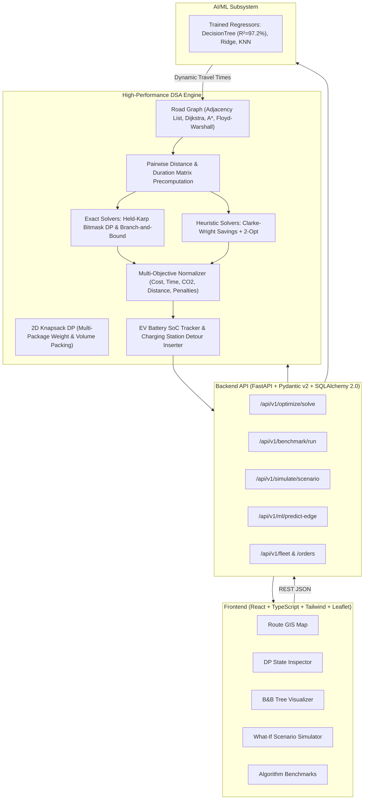

# Intelligent Logistics & Vehicle Routing Optimizer 2.0

[](https://python.org)
[](https://fastapi.tiangolo.com)
[](https://react.dev)
[](https://www.typescriptlang.org)
[](https://tailwindcss.com)
[](https://scikit-learn.org)
[](LICENSE)

An enterprise-grade, university major project and technical portfolio platform that optimizes package assignments and delivery routes across multi-depot, heterogeneous fleets. Built from first principles using core Data Structures and Algorithms (DSA), Dynamic Programming, Branch and Bound, and Machine Learning.

---

## 1. System Architecture



---

## 2. Core DSA Algorithms & Formulations

| Algorithm | Paradigm | Mathematical Recurrence / Formula | Time Complexity | Space Complexity | Optimality Guarantee |
|---|---|---|---|---|---|
| **Dijkstra's SSSP** | Greedy / Priority Queue | $d[v] = \min(d[v], d[u] + w(u, v))$ | $\mathcal{O}((V + E) \log V)$ | $\mathcal{O}(V + E)$ | Exact Single-Source Optimal |
| **A\* Search** | Informed Graph Search | $f(u) = g(u) + h(u)$, where $h(u) = \frac{\text{haversine}(u, t)}{v_{\max}}$ | $\mathcal{O}((V + E) \log V)$ | $\mathcal{O}(V + E)$ | Exact Point-to-Point Optimal |
| **Floyd-Warshall** | Dynamic Programming | $D^{(k)}[i][j] = \min(D^{(k-1)}[i][j], D^{(k-1)}[i][k] + D^{(k-1)}[k][j])$ | $\Theta(V^3)$ | $\Theta(V^2)$ | All-Pairs Exact Optimal |
| **Held-Karp Bitmask DP** | Dynamic Programming | $dp(S, u) = \min_{v \in S \setminus \{u\}} [dp(S \setminus \{u\}, v) + c(v, u)]$ | $\mathcal{O}(n^2 2^n)$ | $\mathcal{O}(n 2^n)$ | Globally Optimal Hamiltonian Tour |
| **2D Knapsack DP** | Dynamic Programming | $DP[w][v] = \max(DP[w][v], DP[w - w_i][v - v_i] + p_i)$ | $\mathcal{O}(N \cdot W \cdot V)$ | $\mathcal{O}(W \cdot V)$ | Optimal Package Assignment |
| **Branch and Bound** | Tree Search with Pruning | $LB(P) = g(P) + \sum_{j \in \text{unvisited}} \min_{k \neq j} c(k, j)$ | Worst-case $\mathcal{O}(n!)$ | $\mathcal{O}(n)$ | Exact Optimal with Time Windows |
| **Clarke-Wright Savings** | Constructive Heuristic | $s(i, j) = c(0, i) + c(0, j) - c(i, j)$ | $\mathcal{O}(n^2 \log n)$ | $\mathcal{O}(n^2)$ | Polynomial Approximation |
| **2-Opt Local Search** | Iterative Improvement | Reconnect $(u, v)$ and $(u+1, v+1)$ if $c_{\text{new}} < c_{\text{old}}$ | $\mathcal{O}(K \cdot n^2)$ | $\mathcal{O}(1)$ | Local Optimal Tour |

---

## 3. Machine Learning Integration

- **Model Architectures:** Evaluates Linear Regression, Ridge Regression (L2), Decision Tree Regressor, and K-Nearest Neighbors (KNN).
- **Features Observed:** Road segment distance, speed limit, hour of day (rush hour curves), day of week, weather conditions (clear, rain, fog, storm), and congestion indices.
- **Evaluation Metrics (on Holdout Test Set):**
  - **Decision Tree Regressor (Best Model):** MAE: `2.04 min`, RMSE: `3.43 min`, $R^2 = \mathbf{0.9726}$ ($97.3\%$ variance explained).
  - **Ridge Regression:** MAE: `5.27 min`, RMSE: `7.72 min`, $R^2 = 0.8616$.
  - **KNN Regressor:** MAE: `3.18 min`, RMSE: `4.97 min`, $R^2 = 0.9427$.
- **Dynamic Feedback Loop:** The predicted segment travel times are dynamically injected into the `RoadNetworkGraph` edge weights prior to routing optimization.

---

## 4. Installation & Quickstart

### Prerequisites
- Python 3.11+
- Node.js v18+ and npm
- C++ Compiler (GCC / Clang for optional C++ engine)

### 4.1 Backend Setup
```bash
# Clone the repository
git clone https://github.com/your-username/major-project.git
cd major-project

# Install Python dependencies
pip install -r backend/requirements.txt

# Seed SQLite database with sample depots, vehicles, and orders
set PYTHONPATH=backend
python backend/app/core/seed_data.py

# Start the FastAPI server
uvicorn app.main:app --app-dir backend --reload --port 8000
```
API Documentation will be available at: `http://localhost:8000/docs`

### 4.2 Frontend Setup
```bash
cd frontend

# Install npm dependencies
npm install

# Start Vite development server
npm run dev
```
Open your browser at: `http://localhost:5173`

---

## 5. Running Automated Verification Suite

Run all automated unit, integration, and constraint tests:
```bash
set PYTHONPATH=backend
pytest backend/tests/ -v
```

Test coverage includes:
- `test_graph_algorithms.py`: Dijkstra SSSP, A* with Haversine heuristic, Floyd-Warshall APSP, dynamic road closure detours.
- `test_dp_algorithms.py`: Bitmask DP vs. Brute-force $O(n!)$ ground-truth verification on $N \in [4, 6]$, route reconstruction, 2D Knapsack capacity boundaries.
- `test_branch_and_bound.py`: Branch & Bound vs. Bitmask DP optimality, time-window pruning, capacity pruning.
- `test_vrptw_constraints.py`: Edge cases (zero deliveries, oversized packages, EV battery depletion).
- `test_api_endpoints.py`: Full REST API integration testing across all routes.

---

## 6. Project Directory Layout

```text
major-project/
├── backend/
│   ├── app/
│   │   ├── api/             # FastAPI REST endpoints
│   │   ├── core/            # Config, database engine, seeder
│   │   ├── dsa/             # Core DSA algorithms (Graph, DP, B&B, Clarke-Wright, EV)
│   │   ├── ml/              # Traffic dataset generator, trainer, dynamic predictor
│   │   ├── models/          # SQLAlchemy 2.0 ORM models
│   │   ├── schemas/         # Pydantic v2 schemas
│   │   └── main.py          # FastAPI application entrypoint
│   ├── tests/               # Pytest automated test suite
│   └── requirements.txt
├── engine_cpp/
│   ├── include/             # C++ Bitmask DP headers
│   └── src/                 # C++ Bitmask DP source with POPCNT instructions
├── frontend/
│   ├── src/
│   │   ├── components/      # MapView, DpMatrixVisualizer, BbTreeVisualizer, Simulator, Benchmarks
│   │   ├── services/        # Axios API client
│   │   ├── types/           # TypeScript interfaces
│   │   └── App.tsx          # Main React application
│   ├── package.json
│   └── vite.config.ts
├── docs/
│   ├── PRD_AND_SPECIFICATION.md
│   └── VIVA_PREPARATION_GUIDE.md
├── data/
│   ├── sample_network.json  # Directed metropolitan road network
│   └── sample_orders.json   # Delivery requests with time windows
└── README.md
```

---

## 7. License
This project is open-source under the [MIT License](LICENSE).
